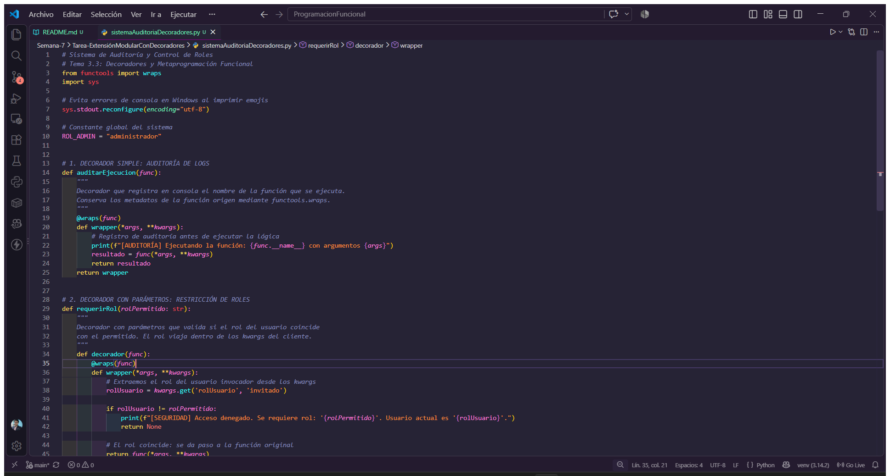
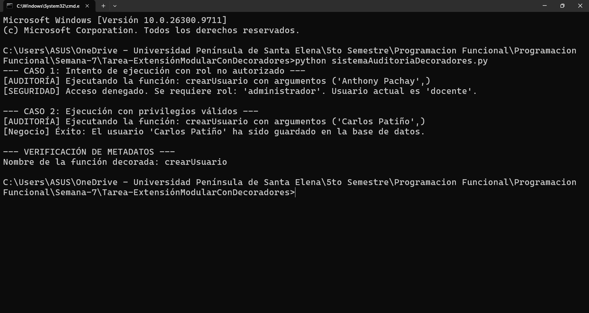

<div align="center">

# 🛠️ Extensión Modular con Decoradores

### Tema 3.3 · Decoradores y Metaprogramación Funcional


**Sistema de auditoría y control de roles para el núcleo de base de datos,**
**construido con funciones de orden superior y closures.**

</div>

## 1. 🎯 Contexto y Objetivo

Añadir comportamientos transversales (auditoría de logs y control de acceso por roles) a funciones puras de negocio **sin tocar una sola línea de su código interno**, aplicando el principio Open/Closed mediante decoradores que envuelven la función origen apoyándose en cierres (*closures*).

Arquitectura general del script [`sistemaAuditoriaDecoradores.py`](sistemaAuditoriaDecoradores.py):


Decoradores apilados sobre la función de negocio (la auditoría queda encima para registrar también los accesos denegados):

```python
@auditarEjecucion
@requerirRol(ROL_ADMIN)
def crearUsuario(nombreUsuario: str, rolUsuario: str):
```

## 2. Evidencia del Script Funcional

Código fuente de Python libre de errores sintácticos con los cuatro requisitos de la actividad completados:

| Requisito | Implementación |
|:---|---|
| 1. Preservación de metadatos | `@wraps(func)` sobre el `wrapper` del decorador `auditarEjecucion`. |
| 2. Ejecución genérica | `resultado = func(*args, **kwargs)` seguido de `return resultado` en `auditarEjecucion`. |
| 3. Paso de seguridad | `return func(*args, **kwargs)` tras validar el rol en `requerirRol`. |
| 4. Decoradores combinados | Apilado `@auditarEjecucion` + `@requerirRol(ROL_ADMIN)` sobre `crearUsuario`. |



## 3. ✅ Validación y Pruebas de Ejecución

### 3.1. 🚫 Caso 1: Restricción de Acceso

Se invoca la función con rol `docente`: el decorador de seguridad la bloquea **antes de llegar a la lógica de negocio**, no se guarda ningún usuario y la función retorna `None`.

```
--- CASO 1: Intento de ejecución con rol no autorizado ---
[AUDITORÍA] Ejecutando la función: crearUsuario con argumentos ('Anthony Pachay',)
[SEGURIDAD] Acceso denegado. Se requiere rol: 'administrador'. Usuario actual es 'docente'.
```

### 3.2. 💾 Caso 2: Ejecución Autorizada y Auditoría

Con rol `administrador` la petición atraviesa ambos decoradores: la auditoría registra la ejecución y el pipeline de negocio guarda al usuario y retorna `True`.

```
--- CASO 2: Ejecución con privilegios válidos ---
[AUDITORÍA] Ejecutando la función: crearUsuario con argumentos ('Carlos Patiño',)
[Negocio] Éxito: El usuario 'Carlos Patiño' ha sido guardado en la base de datos.
```

### 3.3. 🔏 Comprobación de Preservación de Metadatos (functools.wraps)

Al consultar el nombre de la función decorada, `functools.wraps` expone el nombre original de la lógica de negocio y **nunca** el nombre del contenedor (`wrapper`), gracias a la copia de `__name__`, `__doc__` y `__module__` de la función origen:

```
--- VERIFICACIÓN DE METADATOS ---
Nombre de la función decorada: crearUsuario
```

### 3.4. 🖥️ Captura de Consola

Evidencia real de la ejecución del script en la terminal con los tres bloques anteriores completos:



## 4. Cuestionario de Análisis Técnico

### 4.1.  Análisis del Orden de Ejecución (Pregunta 1)

**¿Cuál decorador se ejecuta primero al apilar varios y por qué el orden altera el comportamiento arquitectónico del sistema?**

Al apilar varios decoradores, **se aplican de abajo hacia arriba, pero se ejecutan de arriba hacia abajo.**

Con la estructura del script:

```python
@auditarEjecucion
@requerirRol(ROL_ADMIN)
def crearUsuario(...):
```

Python hace la equivalencia real de composición de funciones: primero decora `requerirRol(ROL_ADMIN)` (la más cercana a la función), y luego `auditarEjecucion` envuelve ese resultado:

```python
crearUsuario = auditarEjecucion(requerirRol(ROL_ADMIN)(crearUsuario))
```

Por eso, en tiempo de ejecución el decorador superior (`auditarEjecucion`) actúa como **puerta de entrada**: recibe cada llamada primero y decide si el decorador de abajo se llega a ejecutar. El orden altera el comportamiento arquitectónico porque cada decorador intercepta el resultado del siguiente; si se invirtieran (seguridad arriba, auditoría abajo), primero se bloquearía el acceso y **solo se auditarían las llamadas autorizadas**, perdiendo el rastro de los intentos denegados. Elegir el orden es, en esencia, elegir qué capa se consulta primero en el pipeline de la aplicación.

### 4.2. Análisis de la Preservación de Estado (Pregunta 2)

**¿Cómo funciona una clausura y de qué manera permite que el wrapper mantenga acceso a las variables externas?**

Una **clausura (closure)** es una función interna definida dentro de otra función externa que **captura variables libres** del ámbito de esa función externa, manteniendo vivas dichas variables después de que la externa terminó.

En Python, cuando el intérprete detecta que `wrapper` referencia nombres que no existen en `wrapper` ni son locales (aquí `func` y `rolPermitido`), no crea variables locales, sino que registra esos nombres como variables libres y **captura cada variable en un objeto `cell`** (celda de memoria) que queda accesible en la celda interna de la clausura:

```python
print(crearUsuario.__closure__)        # tupla de objetos cell, una por variable libre
print(crearUsuario.__closure__[0].cell_contents)  # referencia a func o a rolPermitido
```

Este mecanismo permite que el `wrapper` mantenga acceso a `func` y a `rolPermitido` **incluso cuando la ejecución del decorador ya finalizó**, gracias a que:

- El ciclo de vida ya no depende de la función externa; la variable vive mientras exista la referencia a la celda.
- El `wrapper` guarda en su `__closure__` las celdas que permiten **leer** (no reasignar) esas variables.
- La auditoría retiene la función origen con `func` y el control de roles retiene `rolPermitido`, resueltos una sola vez al aplicar el decorador en tiempo de importación.

| Decorador | Variable capturada | Duración |
|:---|---|---|
| `auditarEjecucion` | `func` | Mientras exista el `wrapper` decorado |
| `requerirRol` | `rolPermitido` | En el pipeline de la aplicación |


## ▶️ Ejecución

```powershell
py sistemaAuditoriaDecoradores.py
```
